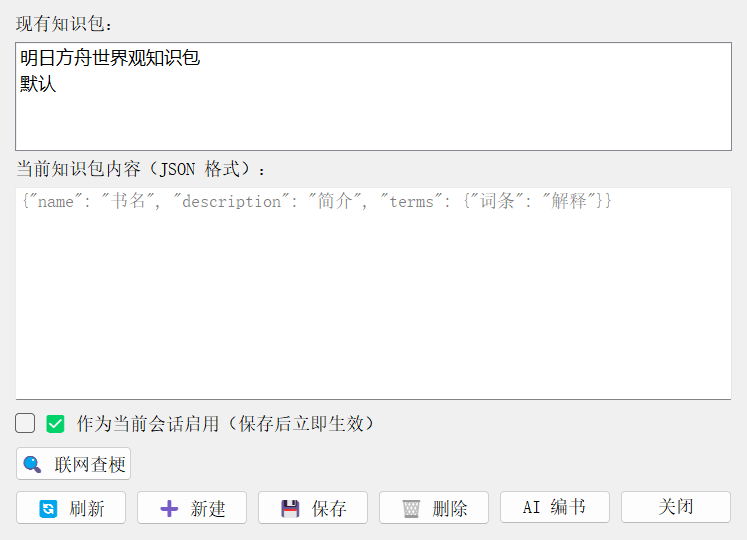

# Cf 助手 · ck-assistant

把一段聊天记录（或聊天截图）丢进去，让模型告诉你**局势、对方真实意图、好感度、危险等级、以及下一句该怎么回**——一个给自己用的"聊天军师"。

桌面悬浮窗、网页、Galgame 三种界面，共用同一颗大脑（`engine.py`）。

当前版本：**v3.1**（代码目录仍叫 `ck_assistant_v3.0`，沿用旧路径，免得桌面快捷方式和 bat 失效）。



> 上图：v3.1 的世界书面板（列表 / JSON 编辑器 / 启用勾选 / AI 编书 / 新增的联网查梗）。

## 它能做什么

| 功能 | 说明 |
|---|---|
| **战况分析** | 输入聊天记录或截图，输出「局势 / 真实意图 / 好感度 0–100 / 危险等级 / 最佳动作」 |
| **多风格回复** | 稳妥、幽默、高冷、发疯四档，可叠"发疯/更疯/攻击性"开关 |
| **对象设定** | 给每个人设写人设与关系，分析时自动注入 |
| **风格克隆** | 贴一段你以前的话，提取说话风格；也能填"个人风格"影响所有输出 |
| **世界书** | 多本知识包（词条 / 热度 / 关系 / 剧情），支持勾选启用、AI 编书、联网查梗 |
| **情景模拟** | 常见场景模板 + 自定义情景 |
| **存档** | 会话内多存档，随时回到某个节点 |

## 快速开始

要求：Windows + Python 3.10 以上（开发环境 3.14）。

```bash
cd ck_assistant_v3.0
pip install -r requirements.txt
python main.py          # 或双击 "2-日常启动（静默版）.bat"
```

首次运行会在 `~/.cf_assistant/config.json` 生成配置，默认 provider 是 DeepSeek（`https://api.deepseek.com/v1`，模型 `deepseek-chat`）。在界面右上角的设置里填自己的 API Key 即可，也可以直接改 JSON 里的 `custom_providers`。

## 三种形态

| 形态 | 启动 | 地址 / 入口 |
|---|---|---|
| 桌面悬浮窗 | `python main.py` | 无边框窗口 + 托盘，全局热键 |
| 网页版 | `python api.py` | <http://localhost:8000> |
| Galgame 版 | `python api.py` | <http://localhost:8000/galgame> |

桌面版快捷键：`Ctrl+Shift+J` 分析剪贴板、`Ctrl+Shift+S` 截图分析、`Ctrl+Shift+Q` 退出。

> 网页版必须在 `ck_assistant_v3.0` 目录下启动（`api.py` 用相对路径读 `index.html` / `galgame.html`）。
> 想让手机连，把 `api.py` 监听地址改成 `0.0.0.0`，然后访问 `http://电脑IP:8000`。

## 目录结构

```
ck_assistant_v3.0/     ← 当前版本（内含 v3.1），唯一在维护的目录
ck_assistant_v2.4/     ┐
ck_assistant_v2.3_sp/  │ 历史快照，仅作存档：每个版本是当时的一次
ck_assistant_v2.3/     │ 完整拷贝，互相之间没有共享代码
ck_assistant_v2.2/     │
ck_assistant_v2.1/     │
ck_assistant_v2.0/     │
ck_assistant_v1.0/     ┘
```

`ck_assistant_v3.0/` 里的文件：

| 文件 | 作用 |
|---|---|
| `engine.py` | 全部业务逻辑：调模型、解析 JSON、世界书、联网搜索、存档 |
| `engine_config.py` | 配置读写与迁移（`~/.cf_assistant/config.json`） |
| `main.py` | 桌面版入口（热键、托盘、单实例） |
| `ui.py` | 桌面版界面（PyQt5 无边框窗口 + 各弹窗） |
| `ui_settings.py` | 设置面板 |
| `api.py` | FastAPI 后端，给网页版 / Galgame 版用 |
| `index.html` / `galgame.html` | 网页版 / Galgame 版前端 |
| `_debug_logger.py` | 全局日志（`engine.py`、`main.py` 都依赖） |
| `requirements.txt` | 依赖清单 |
| `README.txt` | 面向使用者的详细中文说明（十节，含排错） |

## 数据存在哪

| 路径 | 内容 |
|---|---|
| `~/.cf_assistant/config.json` | provider、Key、模型、界面偏好（**明文 Key**） |
| `~/.cf_assistant/history_<会话>.json` | 每个会话的真实聊天记录 |
| `~/.cf_assistant/context_<会话>.json` | 前情提要 / 上下文 |
| `~/.cf_assistant/lorebooks/*.json` | 世界书 |

这些都在用户目录下，**不在仓库里**（`.gitignore` 已排除）。要备份就整个拷走 `~/.cf_assistant`；要分享代码注意别把 `config.json` 带上。

## 已知限制

- **代理不生效**：`engine.get_client()` 用 `trust_env=False` 的 httpx，系统代理 / `HTTP_PROXY` 环境变量对它无效。要过代理得改这一处或让 `base_url` 直连。
- **联网搜索靠兜底**：优先走 `duckduckgo_search` 库，部分网络（如校园网）会因 TLS 失败，自动落到 Bing 抓取；兜底拿到的是标题 + 摘要，链接未必能打开。
- **仅 Windows**：依赖 PyQt5 托盘与 `keyboard` 全局热键，没有跨平台适配。
- **世界书是 JSON 编辑器**：勾选、新建、AI 编书都能点，但词条内容要手写 JSON，没有表单界面。
- **没有自动化测试**：只有 `py_compile` 与手工冒烟。
- **单一权威**：桌面版把状态放在内存里，进程挂了未保存的分析就没了。

## 更新日志

### v3.1（2026-11-24）

- 清理：删掉 8 个 `*.bak_*` 备份、10 个临时补丁脚本，`.gitignore` 补规则
- 补回 Web 版：`api.py` + `index.html` + `galgame.html`（此前 README 教人跑 `python api.py`，但文件只存在于 v2.4）
- 世界书面板新增 **🔍 联网查梗** 按钮（只查不改书）
- 修 Bing 兜底正则：`<p class=...>` 导致摘要恒为空
- 新增 `requirements.txt`，补上缺失的 `beautifulsoup4` / `duckduckgo_search`
- `README.txt` 与代码对齐（安装、启动、世界书、查梗、代理说明）
- 界面版本号统一为 v3.1（窗口标题 / 托盘 / 就绪页 / 设置窗口 / 启动脚本）
- 移除内部交接文档（`HANDOVER.md`、`HANDOVER_DEV.md`、`WORK.txt`、`第三阶段转交说明书.txt`），仓库转为公开
- 以 **GPL-3.0** 开源，源码文件加 SPDX 头

### v3.0（2026-10）

- 三形态统一到一颗 `engine.py`；世界书、情景模拟、存档、风格克隆

## 许可

以 **GNU General Public License v3.0** 发布，完整条款见 [LICENSE](LICENSE)。

- **可以**：自由使用、修改、分发，包括商业用途
- **要求**：分发（含修改版）时必须以同样的 GPL-3.0 开源并附上源代码，保留版权与许可声明
- **不提供担保**：软件按"现状"提供

> 为什么是 GPL-3.0 而不是 MIT：本项目依赖 PyQt5，PyQt5 本身以 GPL v3 授权（商用需另购 Riverbank 商业许可）。选 GPL-3.0 与依赖的许可保持一致，不用在许可上打补丁。

Copyright (c) 2026 Wei Qiguang (weijeff114)
